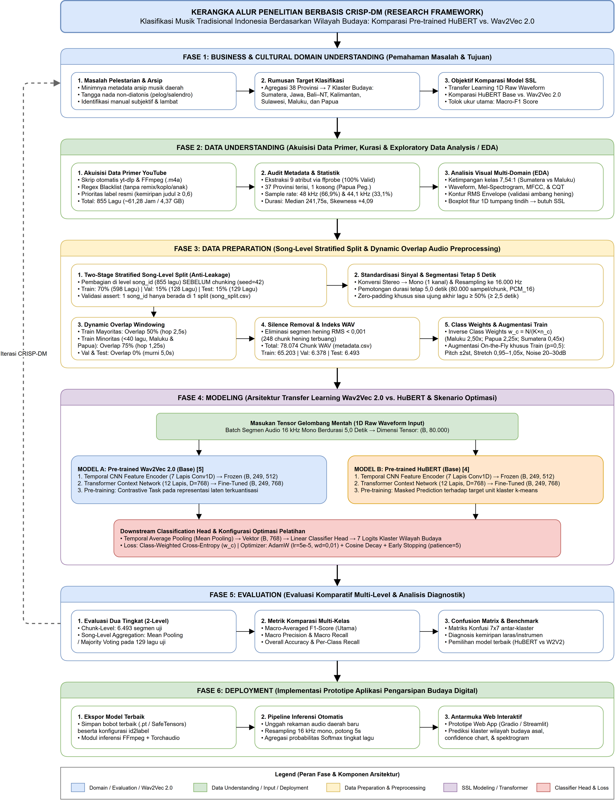
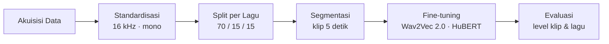
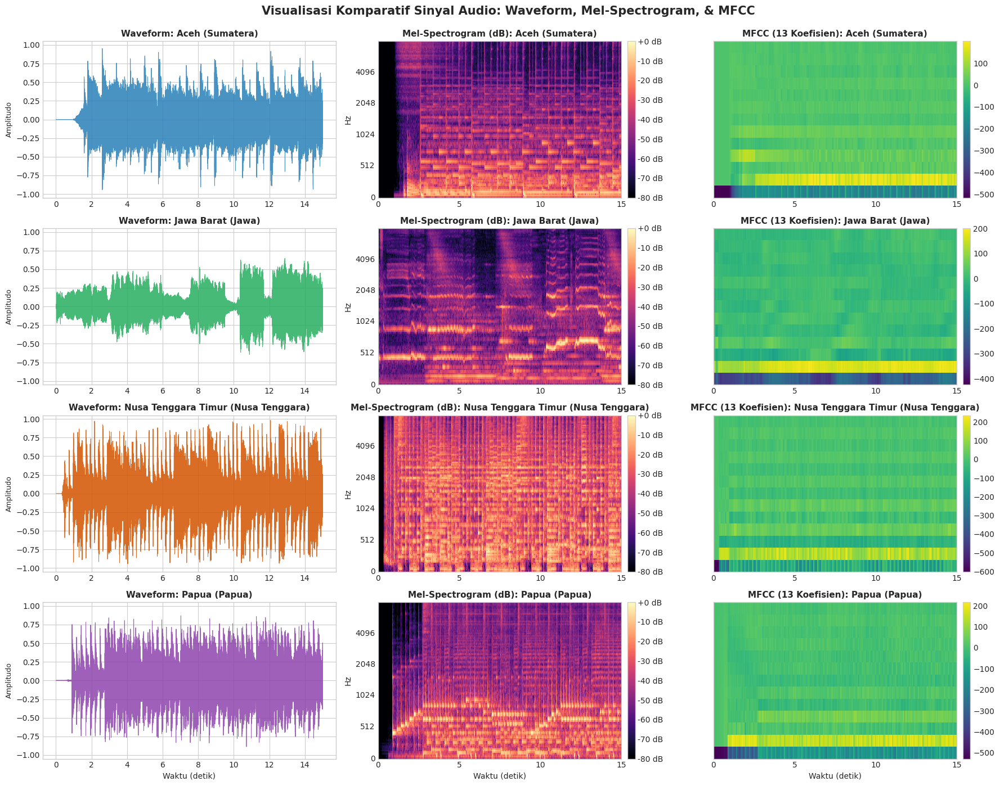
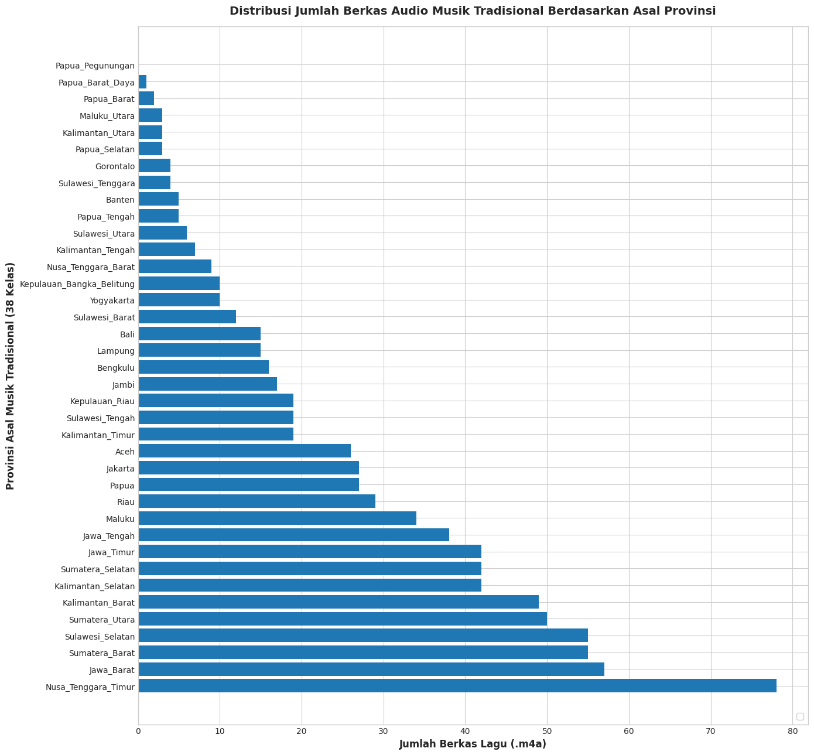
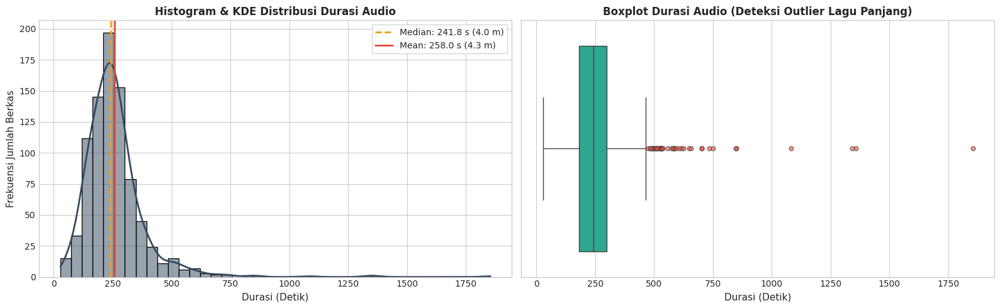
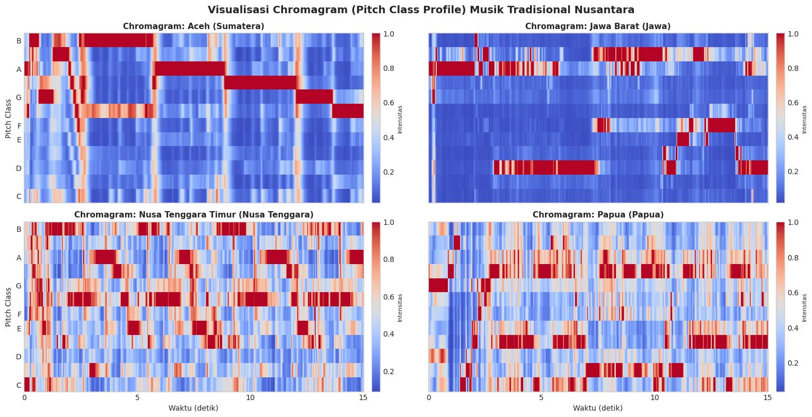
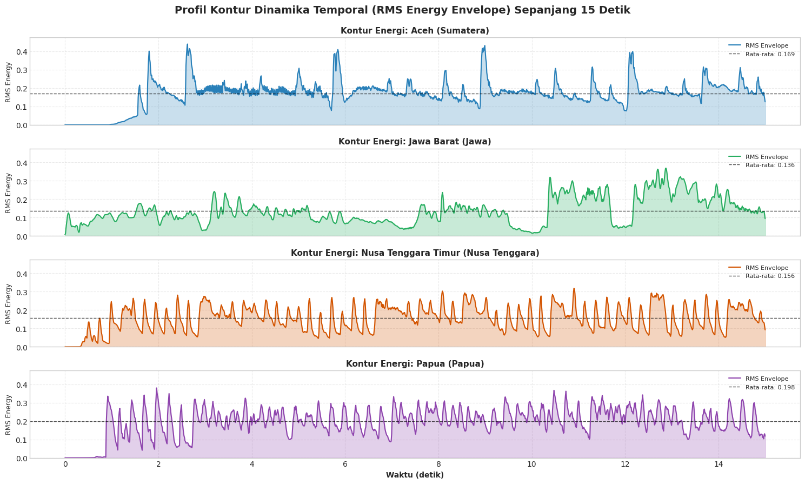
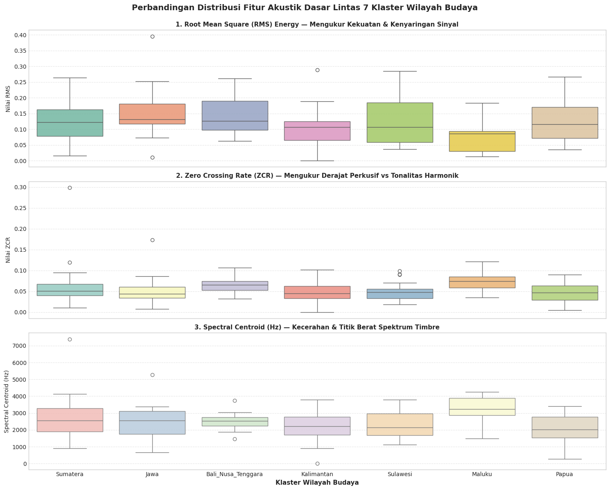
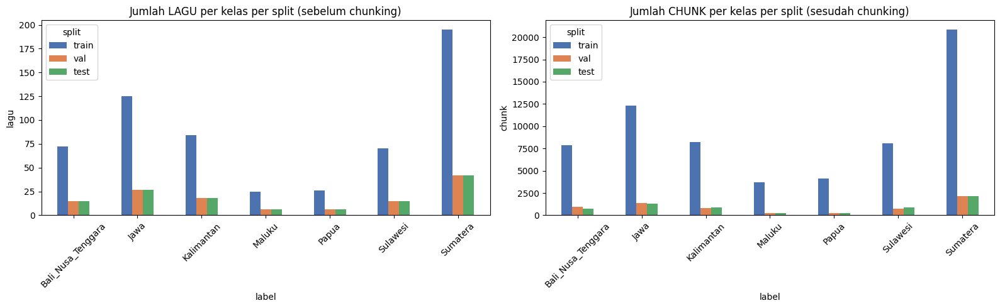

<div align="center">

# Klasifikasi Musik Tradisional Indonesia

**Klasifikasi asal daerah musik tradisional Indonesia menggunakan Audio Transformer berbasis *self-supervised learning***

[](https://www.python.org/)
[](https://pytorch.org/)
[](https://huggingface.co/docs/transformers)
[](https://librosa.org/)
[](#roadmap)

[Ringkasan](#ringkasan) · [Dataset](#dataset) · [Metodologi](#metodologi) · [Model](#model) · [Analisis Eksplorasi](#analisis-eksplorasi) · [Memulai](#memulai) · [Roadmap](#roadmap)

</div>

---

## Ringkasan

Musik tradisional Indonesia tersebar di 38 provinsi, namun sebagian besar rekamannya belum memiliki metadata asal daerah yang terstandarisasi. Proyek ini mengembangkan sistem klasifikasi audio yang mampu mengenali **wilayah budaya** asal sebuah lagu tradisional langsung dari gelombang suara mentahnya (*raw waveform*).

Penelitian ini membandingkan dua model representasi suara berbasis *self-supervised learning*, yaitu **Wav2Vec 2.0** dan **HuBERT**, yang di-*fine-tune* pada korpus musik tradisional Indonesia hasil kurasi, dengan tujuan mendukung pelestarian digital warisan musik nusantara.

<table>
  <tr>
    <td align="center"><b>855</b><br><sub>lagu</sub></td>
    <td align="center"><b>61,3 jam</b><br><sub>audio mentah</sub></td>
    <td align="center"><b>38</b><br><sub>provinsi</sub></td>
    <td align="center"><b>7</b><br><sub>wilayah budaya</sub></td>
    <td align="center"><b>78.074</b><br><sub>klip 5 detik</sub></td>
  </tr>
</table>

---

## Dataset

Rekaman dikumpulkan dari sumber resmi dan kanal rujukan budaya, lalu disaring untuk membuang versi remix, cover, kompilasi, dan aransemen non-tradisional. Karena beberapa provinsi memiliki kurang dari lima lagu, provinsi dikelompokkan ke dalam **tujuh wilayah budaya** agar pembagian data tetap valid secara statistik.

| Wilayah | Provinsi | Lagu | Train | Val | Test | Klip |
| :--- | :---: | ---: | ---: | ---: | ---: | ---: |
| Sumatera | 10 | 279 | 195 | 42 | 42 | 25.142 |
| Jawa | 6 | 179 | 125 | 27 | 27 | 15.019 |
| Kalimantan | 5 | 120 | 84 | 18 | 18 | 9.897 |
| Bali & Nusa Tenggara | 3 | 102 | 72 | 15 | 15 | 9.534 |
| Sulawesi | 6 | 100 | 70 | 15 | 15 | 9.623 |
| Papua | 6 | 38 | 26 | 6 | 6 | 4.638 |
| Maluku | 2 | 37 | 25 | 6 | 6 | 4.221 |
| **Total** | **38** | **855** | **597** | **129** | **129** | **78.074** |

Pengelompokan wilayah menurunkan ketimpangan jumlah lagu antar kelas dari **78 : 1** menjadi **7,5 : 1** tanpa membuang satu pun rekaman.

> [!NOTE]
> Berkas audio tidak disimpan di repositori ini. Dataset lengkap tersedia di [Google Drive](https://drive.google.com/drive/folders/1KSv0_nllF87kADHO6I5xPUZ02q7meFsl?usp=sharing). Folder [`metadata/`](metadata/) berisi indeks klip, pembagian data per lagu, dan bobot kelas yang dibutuhkan untuk mereproduksi eksperimen.

---

## Metodologi

Proyek ini mengikuti kerangka kerja **CRISP-DM**.

<div align="center">
  
</div>

<br>



### Prapemrosesan

| Tahap | Konfigurasi |
| :--- | :--- |
| Format | WAV PCM 16-bit, 16 kHz, mono |
| Panjang segmen | 5,0 detik (80.000 sampel) |
| Pembagian data | Stratified 70 / 15 / 15 di **tingkat lagu**, dilakukan sebelum segmentasi |
| Overlap (train) | 50% untuk wilayah mayoritas; 75% untuk wilayah minoritas (Maluku, Papua) |
| Overlap (val / test) | Tanpa overlap, agar sampel evaluasi independen |
| Penghapusan hening | Klip dengan energi RMS < 0,001 dibuang |
| Penanganan sisa | Sisa ≥ 2,5 detik diberi *zero-padding*; sisa yang lebih pendek dibuang |
| Penyeimbangan kelas | Bobot kelas *inverse-frequency* yang dinormalisasi |

### Integritas Data

Setiap klip yang berasal dari satu lagu hanya masuk ke satu partisi. Hal ini mencegah model diuji pada rekaman yang sebagian sudah pernah dilihat saat pelatihan, yang merupakan penyebab umum akurasi yang menggelembung pada klasifikasi audio berbasis segmen.

### Protokol Evaluasi

Model dievaluasi pada dua tingkat:

- **Level klip** — prediksi pada setiap segmen 5 detik (6.493 klip uji).
- **Level lagu** — probabilitas softmax dirata-ratakan dari seluruh klip dalam satu lagu sebelum diambil argmax (129 lagu uji).

Metrik yang dilaporkan: akurasi, macro precision, macro recall, macro F1, weighted F1, dan confusion matrix.

---

## Model

| | Wav2Vec 2.0 | HuBERT |
| :--- | :--- | :--- |
| Checkpoint | [`facebook/wav2vec2-base`](https://huggingface.co/facebook/wav2vec2-base) | [`facebook/hubert-base-ls960`](https://huggingface.co/facebook/hubert-base-ls960) |
| Tujuan pra-pelatihan | *Contrastive learning* dengan target terkuantisasi | Prediksi *masked* atas unit tersembunyi hasil klasterisasi |
| Input | Gelombang suara mentah, 80.000 sampel | Gelombang suara mentah, 80.000 sampel |
| Encoder | CNN 7 lapis + Transformer 12 lapis | CNN 7 lapis + Transformer 12 lapis |

Kedua *backbone* menggunakan *classification head* yang identik:

```
waveform → CNN feature encoder → Transformer encoder (T × 768)
         → temporal mean pooling → Linear(768, 256) → GELU → LayerNorm
         → Dropout → Linear(256, 7)
```

---

## Analisis Eksplorasi

<div align="center">
  
  <br><sub>Representasi waveform, Mel-spectrogram, dan MFCC lintas wilayah</sub>
</div>

<br>

<table>
  <tr>
    <td width="50%" align="center"><br><sub>Jumlah lagu per provinsi</sub></td>
    <td width="50%" align="center"><br><sub>Distribusi durasi rekaman</sub></td>
  </tr>
  <tr>
    <td width="50%" align="center"><br><sub>Chromagram (profil kelas nada)</sub></td>
    <td width="50%" align="center"><br><sub>Selubung energi RMS</sub></td>
  </tr>
  <tr>
    <td width="50%" align="center"><br><sub>Fitur akustik dasar per wilayah</sub></td>
    <td width="50%" align="center"><br><sub>Jumlah lagu per wilayah dan split</sub></td>
  </tr>
</table>

Deskriptor tingkat rendah (RMS, *zero-crossing rate*, *spectral centroid*) menunjukkan tumpang tindih yang besar antar wilayah, sehingga dibutuhkan representasi yang dipelajari dari *encoder* Transformer pra-latih.

---

## Struktur Repositori

```text
.
├── notebooks/
│   ├── 01_eda.ipynb                 # Analisis data eksploratif
│   └── 02_preprocessing.ipynb       # Standardisasi, pembagian data, segmentasi
├── scripts/
│   ├── scraper_youtube_audio.py     # Akuisisi dan kurasi audio
│   └── extract_notebook_images.py   # Ekspor gambar dari notebook
├── metadata/
│   ├── metadata.csv                 # Indeks seluruh 78.074 klip
│   ├── song_split.csv               # Pembagian train / val / test per lagu
│   └── class_weights.json           # Bobot kelas dan pemetaan label
├── assets/                          # Diagram dan grafik
├── docs/
│   └── Project_Report.pdf           # Laporan proyek lengkap
└── requirements.txt
```

---

## Memulai

**Prasyarat:** Python 3.10+, [FFmpeg](https://ffmpeg.org/)

```bash
git clone https://github.com/ChrisZo11/klasifikasi-musik-tradisional-indonesia.git
cd klasifikasi-musik-tradisional-indonesia
pip install -r requirements.txt
```

Unduh dataset dari [Google Drive](https://drive.google.com/drive/folders/1KSv0_nllF87kADHO6I5xPUZ02q7meFsl?usp=sharing) dan letakkan di root repositori:

```text
data/          # rekaman .m4a mentah, satu folder per provinsi
processed/     # klip .wav 5 detik (train / val / test)
```

Lalu jalankan notebook secara berurutan, dimulai dari `notebooks/01_eda.ipynb`.

---

## Roadmap

- [x] Akuisisi dan kurasi audio (855 lagu, 38 provinsi)
- [x] Analisis data eksploratif
- [x] Pipeline pembagian data per lagu dan segmentasi
- [ ] Fine-tuning Wav2Vec 2.0
- [ ] Fine-tuning HuBERT
- [ ] Evaluasi komparatif pada level klip dan lagu

---

## Tim

Dikembangkan oleh Kelompok 06 untuk mata kuliah **IS794 Deep Learning**.

| Nama | NIM |
| :--- | :---: |
| Christian Zoe Beru Tena | 00000108336 |
| Kelvin Alexander | 00000106797 |
| Valentino Candako Hardi | 00000107746 |
| Alfonsus Ronaldy Hidayat | 00000112181 |
| Bimo Sekti Mahardika | 00000126658 |

---

## Referensi

1. Baevski, A., Zhou, Y., Mohamed, A., & Auli, M. (2020). *wav2vec 2.0: A Framework for Self-Supervised Learning of Speech Representations.* NeurIPS 33.
2. Hsu, W.-N., Bolte, B., Tsai, Y.-H. H., Lakhotia, K., Salakhutdinov, R., & Mohamed, A. (2021). *HuBERT: Self-Supervised Speech Representation Learning by Masked Prediction of Hidden Units.* IEEE/ACM TASLP, 29, 3451–3460.
3. Yuan, R., et al. (2023). *MARBLE: Music Audio Representation Benchmark for Universal Evaluation.* NeurIPS Datasets & Benchmarks.
